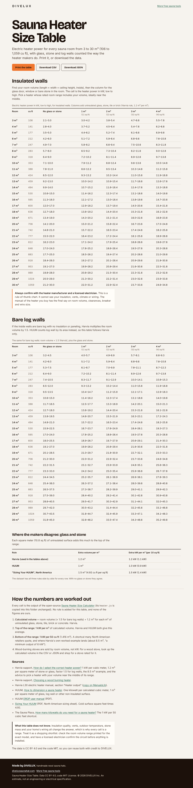
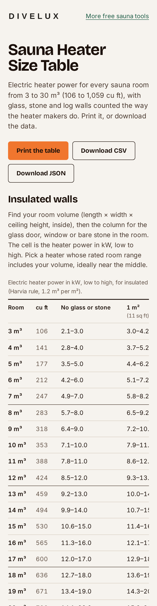

# Sauna Heater Size Table

A printable chart and a small open dataset: electric sauna heater power in kW for every room from **3 to 30 m³ (106 to 1,059 cu ft)**, with 0 to 4 m² (0 to 43 sq ft) of uninsulated glass or stone, with and without bare log walls. Every number comes from the heater makers' published sizing rules, computed by the same code as the [Sauna Heater Size Calculator](https://divelux.github.io/sauna-heater-calculator/).

- **Version:** 1.0 (2026-11)
- **Publisher:** DIVELUX, makers of handmade wool sauna hats (https://diveluxsaunahat.com)
- **License:** data CC BY 4.0, code MIT
- **Rows:** 280 (28 volumes × 5 glass areas × log or not), 13 columns





> **Always confirm with the heater manufacturer and a licensed electrician.** This is a rule-of-thumb chart. It cannot see your insulation, vents, climate or wiring. The manual of the heater you buy has the final say on room volume, clearances, breaker and wire size.

## What is here

| File | What it is |
| --- | --- |
| `index.html` | The chart as a web page, with a print stylesheet (US Letter, three pages) |
| `sauna-heater-size-table.pdf` | The same chart printed to PDF |
| `sauna_heater_sizing.csv` | The dataset, one row per room / glass area / wall type, UTF-8 |
| `sauna_heater_sizing.json` | The same rows plus the column dictionary; empty cells are `null` |
| `heater.js` | The sizing rules, copied unchanged from the Sauna Heater Size Calculator (MIT) |
| `build.js` | Generates the CSV, the JSON and the two tables in `index.html` from `heater.js` |
| `print.js` | The print button |
| `test.js` | Checks every row by independent arithmetic, that the files are fresh, and that the printed cells match the data |
| `dataset-metadata.json`, `CITATION.cff` | Kaggle metadata and citation file |
| `LICENSE`, `LICENSE-DATA` | MIT for the code, CC BY 4.0 for the data and the chart |

## How to read the chart

1. Measure the hot room inside: length × width × ceiling height. That is the room volume.
2. Find the column for the glass door, window or bare stone, tile or brick in the room. Area is width × height; a glass door 2 ft × 6 ft is 12 sq ft, about 1.1 m².
3. The cell is the electric heater power in kW, low to high. Pick a heater whose printed room range includes your volume, ideally near the middle (Harvia's advice).
4. Bare log walls: use the second table.

## The rules

| Rule | Figure | Published by |
| --- | --- | --- |
| Power per volume | 1 kW per m³ (35.3 cu ft) of calculated volume: the high end | Harvia, HUUM |
| Low end of the range | 1 kW per 50 cu ft (1.416 m³) | Retail shortcut; matches Harvia's 8.5 m³ → "minimum output of 6 kW" example |
| Glass, stone, tile, brick, concrete | +1.2 m³ per m² (used in the chart) | Harvia |
| The same, HUUM | +1 m³ per m² | HUUM website and DROP manual |
| The same, HUUM in North America | +4.92 cu ft per sq ft (1.5 m³ per m²) | "Sizing Your HUUM" sheet |
| Bare log walls | room volume × 1.5 | Harvia |

**Calculated volume** = room volume (× 1.5 for bare log) + 1.2 × uninsulated area. kW high = calculated volume × 1. kW low = calculated volume in cu ft ÷ 50. Values are rounded to 0.1 kW by `heater.js`.

HUUM counts a log wall by its area rather than with a factor, so the HUUM columns are empty (`null`) for log rows: we do not guess a HUUM figure.

Wood-burning stoves are sold by room volume, not kW: use `harvia_calc_volume_m3` and shop for a stove rated for it.

## Data dictionary

| Column | Type | Description |
| --- | --- | --- |
| `room_volume_m3` | number | Room volume inside, m³, 3 to 30 |
| `room_volume_cuft` | integer | The same in cu ft (1 m³ = 35.3147 cu ft), rounded |
| `uninsulated_area_m2` | number | Glass, stone, tile, brick or concrete with no insulation behind it: 0, 1, 2, 3 or 4 m² |
| `uninsulated_area_sqft` | number | The same in sq ft (1 m² = 10.7639 sq ft) |
| `log_walls` | boolean | Bare log inside walls (Harvia: room volume × 1.5) |
| `harvia_calc_volume_m3` | number | Harvia calculated volume |
| `harvia_calc_volume_cuft` | integer | The same in cu ft |
| `kw_low` | number | 1 kW per 50 cu ft of Harvia calculated volume |
| `kw_high` | number | 1 kW per m³ of Harvia calculated volume |
| `huum_calc_volume_m3` | number or null | HUUM: room volume + 1 m³ per m²; null for log walls |
| `huum_kw` | number or null | HUUM at 1 kW per calculated m³ |
| `huum_na_calc_volume_m3` | number or null | "Sizing Your HUUM": room volume + 1.5 m³ per m²; null for log walls |
| `huum_na_kw` | number or null | The same at 1 kW per m³ |

## Sources

- Harvia support, [How do I select the correct heater power?](https://support.harvia.com/hc/en-gb/articles/22158995674524-How-do-I-select-the-correct-heater-power) 1 kW per cubic meter, 1.2 m³ per square meter of stone or glass, factor 1.5 for log walls, the 8.5 m³ example, and the advice to pick a heater with your volume near the middle of its range.
- Harvia support, [Choosing a wood burning heater](https://support.harvia.com/hc/en-gb/articles/27407591688476-Choosing-a-wood-burning-heater).
- Harvia L30 electric heater manual, section "Heater output" ([copy on ManualsLib](https://www.manualslib.com/manual/2834310/Harvia-L30.html?page=6)).
- HUUM, [How to dimension a sauna heater](https://huum.eu/how-to-dimension-a-sauna-heater-find-the-proper-power-for-your-sauna/).
- HUUM [DROP user manual](https://huum.eu/wp-content/uploads/2022/05/H1001L02_v6_DROP_User_Manual_EU_2025_PRINT.pdf) (PDF).
- [Sizing Your HUUM](https://cdn.shopify.com/s/files/1/0534/1243/0022/files/Sizing-Your-HUUM-2023.pdf) (PDF, North American sizing sheet).
- The Sauna Place, [How many kilowatts do you need for a sauna heater?](https://www.saunaplace.com/blogs/blogs/how-many-kilowatts-do-you-need-for-a-sauna-heater-a-simple-sizing-guide)

## Rebuild and test

```sh
node build.js   # rewrites the CSV, the JSON and the tables in index.html
node test.js    # 2,201 checks
```

Open `index.html` in a browser, or `python3 -m http.server 8000`. To publish on GitHub Pages: Settings → Pages → Deploy from a branch → `main` / root. Before you publish under your own address, replace `https://divelux.github.io/sauna-heater-sizing-table/` in `index.html`.

## What this is not

Not an engineering or electrical specification. Insulation, vents, outdoor temperature, stone mass and wiring all change the answer, which is why every cell is a range. Brand names belong to their owners; this project is not affiliated with Harvia or HUUM.

## Cite

DIVELUX (2026). *Sauna Heater Size Table* (version 1.0). CC BY 4.0. https://diveluxsaunahat.com/pages/sauna-tools

Made by [DIVELUX](https://diveluxsaunahat.com), handmade wool sauna hats. More free sauna tools: <https://diveluxsaunahat.com/pages/sauna-tools>
